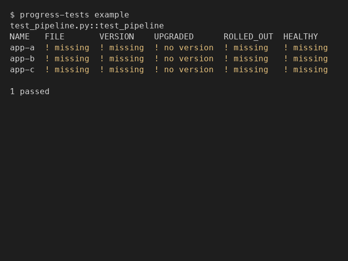

# progress-tests

A library for writing progressive tests: ordered, deterministic checks
that show where a multi-step workflow (e.g. a migration, a phased
rollout) currently stands.



See `docs/design/progress-tests-library.md` for the full design and
`docs/LANGUAGE.md` for terminology.

## Between a progress report and a test

A progressive test's main job is to show progress through a multi-step
workflow while the work is underway. Asked "how far along is it?", you
run the test, and the table answers: which step each input has reached,
and whether anything has gone wrong. It sits between a progress report
and a test. Like a report, it describes where things stand. Like a
test, every step is a deterministic check of real state, and the run
exits non-zero when a step fails, so the answer can be rerun and
trusted rather than recalled or estimated.

That position is why it breaks several usual testing practices on
purpose:

- **It checks live, external state.** The state of the systems doing
  the work is the thing being reported on; a mocked or isolated check
  couldn't see it.
- **It can be slow.** Its steps reach out to those systems, and the
  work it tracks can take hours or days.
- **It has three outcomes, not two.** `WAIT` means "not done yet, but
  on track", the most common and most useful answer while work is in
  flight. Pass/fail alone would report a correctly progressing workflow
  as a failure. Only `FAIL`, a terminal state that won't resolve by
  waiting, fails the test.
- **Its steps branch.** Every step runs on every run, so a step has to
  check whether the things it builds on have happened yet before
  judging its own fact.

What it keeps from testing is the purpose: fast, clear feedback. The
feedback is about progress through the real world, not about whether
code works.

The same shape also works for exploratory checks, and for assessing
the current state of many things with several properties each.

### How one gets built

Building a progressive test runs two test-driven loops.

The outer loop is ordinary TDD. Start from the current state, then
write the end-state step first: the check that the workflow is done.
This is where inputs get chosen. Everything the end state needs has to
be known now; if defining it requires a value some intermediate step
would produce, the end state can't be described up front, and the test
can't drive the work.

The inner loop decomposes the workflow into the smallest steps
possible, the way a refactor does: duplicate a method, show both
behave the same, cut over to the new one, delete the old. Each of
those is an intentional intermediate state. For each piece:

- "How will I know it's done?" is the step's check, and `PASS`.
- "Can I tell how far along it is?" is the `WAIT` message.
- Any terminal state that isn't the desired one is `FAIL`.

Unlike classic TDD, an intermediate state may need no further action,
only time. A rolling deployment under a plain pass/fail check looks
like a failure until it's suddenly done; as a step, it can show how
much traffic has shifted, or how many instances run the new version,
while it moves.

The test can change. Executing the workflow sometimes uncovers things
that were missed, and the test changes to capture the new information:
a check that turns out to hold two facts gets split in two, a piece of
information you wished you'd had gets its own check, and a terminal
state you hadn't anticipated gets a check that reports it as `FAIL`
instead of an endless `WAIT`.

## Usage

```python
from progress_tests import Status, invoke, step


@step("STEP_ONE")
def step_one(case) -> Status:
    if condition_one(case["name"]):
        return Status.PASS("ok")
    return Status.WAIT("waiting")


@step("STEP_TWO")
def step_two(case) -> Status:
    if condition_two(case["name"]):
        return Status.PASS("ok")
    return Status.WAIT("waiting")


def test_migration():
    steps = [step_one, step_two]
    inputs = [
        {"name": "instance-a"},
        {"name": "instance-b"},
    ]
    invoke(steps, inputs)
```

Run it with the bundled runner: `progress-tests [path] [--no-color]`
(`path` defaults to the current directory). It walks `path` for
`test_*.py`/`*_test.py` files, imports them, and calls every top-level
`test_*` function it finds with no arguments — no fixtures, no
parametrize, no plugin system. `invoke()` runs every step, in order,
for each input, regardless of any other step's result, and prints a
color-coded table (one row per input, one column per step) to stdout.
By default, `WAIT` doesn't fail the test (it's the expected state for
something still in progress); `FAIL` always does. Pass
`fail_on_wait=True` to `invoke()` to also fail on `WAIT`.

Inputs run in parallel, on threads: by default every input starts at
once, so a run takes about as long as its slowest input. Each input's
own steps still run in order, and the table always lists inputs in the
order given. Pass `parallelism=N` to run at most `N` inputs at a time
(`parallelism=1` runs them one after another), e.g. to stay under a
rate limit when there are many inputs. Since the same step can run for
several inputs at once, keep per-input state in `case` (pass it between
steps as returned data) rather than in module-level variables or
process-wide state like the working directory or environment, and
report through `Status` messages rather than `print()`, which
interleaves across inputs. `inputs` must not be empty.

Since every step runs regardless of earlier results, a step that reads
data an earlier step would have contributed (via its `PASS` return's
data dict) needs to guard against that data being absent — check for
it before use, the same as any other precondition:

```python
@step("VERIFY_DEPLOYED")
def verify_deployed(case) -> Status:
    if "distribution_id" not in case:
        return Status.WAIT("no id yet")
    return Status.PASS(case["distribution_id"])
```

Color is on by default (even when stdout isn't a terminal, so it
survives being piped through something like `watch --color`). Pass
`--no-color`, or set the `NO_COLOR` environment variable, to suppress
it.

A step can also return a value for later steps on the same input to
use, alongside its `Status`:

```python
@step("STEP_ONE")
def step_one(case) -> tuple[Status, dict]:
    return Status.PASS("ok"), {"example_key": "example_value"}


@step("STEP_TWO")
def step_two(case) -> Status:
    you_can_use = case["example_key"]
    if condition_two(you_can_use):
        return Status.PASS("ok")
    return Status.WAIT("waiting")
```

If a step's returned value would overwrite an existing key — from the
original input, or a previous step — `invoke()` raises `ValueError`
rather than silently picking a value.

### Message guidance

`Status.PASS`/`WAIT`/`FAIL` each take an optional message, shown in
that cell of the table: `Status.WAIT("no backup")` renders as `! no
backup`. Leave it out (`Status.PASS()`) and the cell just shows the
glyph. Keep it short — aim for well under 12 characters. It renders
inline in a fixed-width table column, and a long one widens that
column for every row.

Two `Status`es are equal only when both their kind and message
match — `Status.FAIL("boom") != Status.FAIL("other")` — so don't
compare a step's result against a specific `Status` value in your own
code unless you mean that exact message too.

`@step` automatically attaches a message when a step function raises:
`"assert fail"` for an `AssertionError`, `"exception"` for anything
else. Either way, the full traceback isn't lost — it prints once,
after the whole table, rather than interleaved with it.

When the table itself is the point, such as a large grid read for its
overall shape, pass `show_details=False` to `invoke()`. Only the table
prints: no details or tracebacks after it, and the failure summary
gives a count without naming the inputs.

## Writing good steps

**Check live state, not a status label.** A step runs a real check,
fresh every run, against the thing itself: a DNS lookup, an HTTP
response, a call to a live API, the file on disk. Never a field copied
from a plan or config that says the work is done, and never a proxy
("the resource is named in the repo" is not "the resource exists").
Two runs that both show `PASS` mean the same real condition was
confirmed both times.

**Compare live signals, not constants.** Where possible, check "does
live signal A match live signal B" rather than "does A match a value I
wrote down." A hardcoded expected value goes stale, and can be wrong
for one input even when the rest look uniform.

**One fact per step.** A step that ANDs several independent conditions
has to summarize them, and "not ready" doesn't say which one is the
blocker. Give each fact its own step and column; a later step can then
depend on exactly the fact it needs. The exception is a large fan-out
of the same kind of thing (many instances, many files): keep that as
one step with a count.

**Counts and terminal states.** A step with a count or percentage from
the thing itself reports `PASS` at `y/y` or `100%`, and `WAIT` below
that, with the count as its message (`! 2/5`). It's `FAIL` only when
the thing has reached a state it won't progress out of. `0/0` is
`PASS`: with nothing to do, it's done.

**Short messages; details after the table.** A message should read at
a glance across a row: a count, a short word, a percentage. Anything
longer, such as which of several items is behind, goes in `detail`,
which prints once after the table, labeled by input and step:

```python
return Status.WAIT("2/3", detail="instance 1: v1, want v2+\n")
```

A message that needs to summarize several sub-failures is a sign the
step should be split, or its per-item breakdown moved to `detail`.

**Every cell has a status.** A step that doesn't apply to an input
returns `Status.PASS("n/a")`, a real, reported state, rather than
being left out.

**Read-only and idempotent.** A run only reads state; it never creates,
changes, or consumes anything. Two runs in a row with nothing changed
in between give the same table.

**One test per mechanism.** When the same conceptual step is checked
in genuinely different ways for different kinds of input (a database,
a queue, a bucket), write one test per kind rather than one test that
branches on a `kind` field. Steps that really are identical go in
shared functions each test imports. A new kind is then new code in a
new file, never a new branch in an old one, and each kind's inputs live
as data rather than code.

**Fix inputs at the start.** Every input is known when the workflow
starts. If a step creates a value that a later step needs (a PR URL, a
generated ID), that's a boundary: end this test at that step, and start
another workflow's test with the value as its input. Inside one test,
pass the value forward as step data.

**The table is the answer to "where are we?"** When picking work back
up, run the test and resume from whatever isn't `PASS`, rather than
reconstructing progress from memory, history, or another tracker.

## Dependencies

- Python >= 3.10
- [uv](https://docs.astral.sh/uv/) for dependency management and
  running commands (`uv sync`, `uv run pytest`, `uv run ruff check .`)

## CI

`./test` (lint, format check, the dev test suite, and the example)
runs on every push to `main` — see `.github/workflows/test.yml`.

## Deployment

Not published anywhere (no PyPI, no GitHub releases). Install directly
from this repository if you need it elsewhere.
