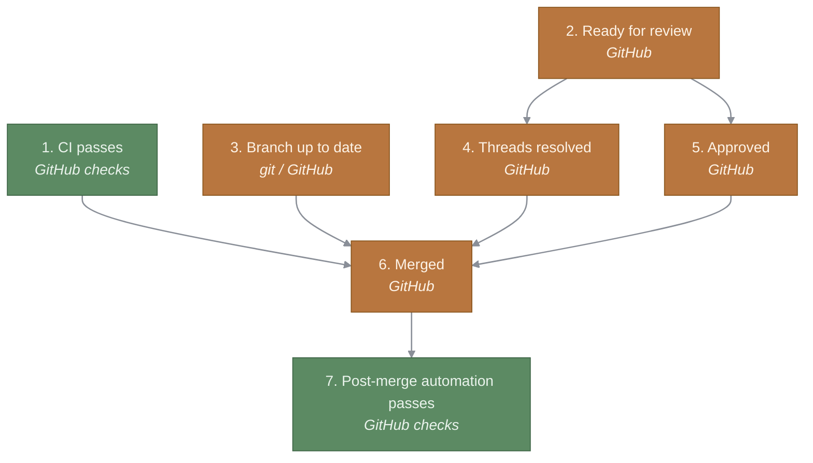

# Pull request

One pull request, from its author's side, from the moment it exists until
it's finished: merged with everything its merge triggered passing, or
closed. The input is the PR's URL. Whatever creates the PR ends where this
process starts, and a larger process can include this whole process as one
of its steps by handing it a PR URL.

Which PRs to look at (all open PRs you authored, one repo's PRs, an org's
PRs from the last week) is chosen outside this process. Each one is a
separate run.

The process ends when automation on the merge commit settles. Releasing to
production is part of this process only when that automation is the
release. A release done separately (a tag, a scheduled train, a promotion)
is its own workflow, which starts from the merge commit.

A closed PR is a valid end, not a mistake: rejecting a change is part of
normal development.

## Shared verification

Every step is verified by the progress test in `test_pull_request.py`,
given one or more PR URLs (see `README.md` for how to run it). Each PR is
a row and each step a column:

- `pass`: the step is done.
- `wait`: the step is waiting on its expected next action or on time.
- `fail`: the step won't move forward without someone correcting
  something. A closed PR fails Merged; that's an accurate report that it
  won't merge unless reopened, not a judgment that closing it was wrong.
- an uncolored informational cell: the step has nothing to verify, such
  as a PR with no checks, or post-merge automation for a closed PR.

The test reports what GitHub says right now, through the `gh` CLI with
read access. It never changes anything.

## Steps

### 1. CI passes

- **actor:** deterministic
- **verification:** deterministic: the most recent run of every check
  reported on the PR's head commit finished successfully, required or not
  (see Shared verification).
- **solution:** each repo's own CI (GitHub Actions or any service
  reporting status checks to GitHub)

Checks start on their own when commits are pushed to the PR's branch. If
one fails, the author reads its log, then pushes a fix or reruns it. A
check that isn't required still counts: its failure needs a decision even
if it wouldn't block the merge. A PR with no checks at all shows that as
informational: there's nothing for this step to verify.

**Rollback:** nothing to undo. Running checks changes nothing outside the
PR.

### 2. Ready for review

- **actor:** human
- **verification:** deterministic: the PR isn't a draft (see Shared
  verification).
- **solution:** —

The author marks the PR ready for review once they want reviewers to look
at it. This says the author intends the change to merge as it stands.

**Rollback:** convert the PR back to a draft.

### 3. Branch up to date

- **actor:** human
- **verification:** deterministic: the PR's branch has no conflicts with
  its base, and isn't behind the base when the base's rules require
  branches to be up to date before merging (see Shared verification).
- **solution:** —

Conflicts need correcting: the author merges or rebases the base into the
branch and resolves them. Being behind only matters when the base branch's
rules block merging a branch that's behind; then the author updates the
branch (GitHub's "Update branch" button, or a merge or rebase pushed from
a clone). Updating the branch triggers CI again.

**Rollback:** reset the branch to its earlier commit and force-push it.
In practice an update is never undone.

### 4. Threads resolved

- **actor:** human
- **verification:** deterministic: every review conversation is resolved,
  when the base branch's rules require conversation resolution before
  merging; otherwise this passes (see Shared verification).
- **solution:** —

The author answers each review comment, with a change or a reply, and
either the author or the reviewer resolves the conversation.

**Rollback:** reopen the conversation.

### 5. Approved

- **actor:** human
- **verification:** deterministic: the PR has as many approvals as its
  base branch's rules require, counting only approvals the rules still
  accept (for example, ones given after the last push), and a code owner
  has approved every file that has one; passes when no review is
  required. Worked out from the base branch's rules and CODEOWNERS,
  because GitHub's own review decision is sometimes missing (see Shared
  verification).
- **solution:** —

The author requests review from whoever the repo needs, and the reviewers
approve. A reviewer requesting changes needs correcting: the author
addresses the feedback and asks for another review.

**Rollback:** a reviewer or admin dismisses the approval. Depending on the
repo's settings, pushing new commits may dismiss it automatically.

### 6. Merged

- **actor:** human
- **verification:** deterministic: the PR is merged; a PR closed without
  merging fails this step (see Shared verification).
- **solution:** —

Once every step before it passes, a person clicks merge on the PR. Merging
puts the change into the base branch and creates the merge commit that
step 7 checks.

At any point while the PR is open, the author, or anyone with write
access, can instead close it when the change won't go ahead as it stands:
it's rejected, replaced by another PR, or no longer needed. Closing ends
the run; there's nothing for step 7 to check.

**Rollback:** a merge can't be undone. It can be reversed with a revert
PR, which is its own run of this process. A close is undone by reopening
the PR, which isn't possible once its branch is deleted or force-pushed
past the PR's commits.

### 7. Post-merge automation passes

- **actor:** deterministic
- **verification:** deterministic: every workflow run triggered by the
  merge commit finished successfully, or a newer run of the same workflow
  on the base branch did (see Shared verification).
- **solution:** each repo's own post-merge workflows

Pushing the merge commit to the base branch starts whatever the repo runs
on that branch: builds, publishing, deploys. If a run fails, someone fixes
the cause, usually with another PR, whose own post-merge run then counts
as newer. A merge that triggers nothing passes this step.

**Rollback:** nothing to undo for the runs themselves. Anything they
deployed is rolled back by that deploy's own mechanism.

## Tools

- [GitHub pull requests](https://docs.github.com/en/pull-requests): where
  every step happens
- [GitHub Actions](https://docs.github.com/en/actions) and
  [status checks](https://docs.github.com/en/pull-requests/collaborating-with-pull-requests/collaborating-on-repositories-with-code-quality-features/about-status-checks):
  CI and post-merge automation
- [gh CLI](https://cli.github.com/manual/): how the progress test reads
  GitHub
- [progress-tests](https://github.com/brianberzins/progress-tests): the
  library the progress test is written with
- `test_pull_request.py`: the progress test for this process
